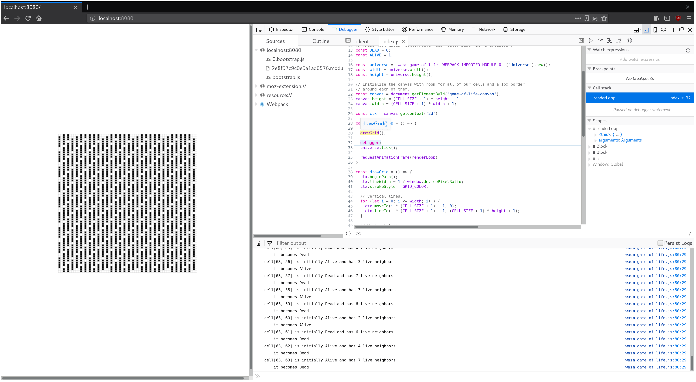

# Отладка

Прежде чем писать ещё много кода, стоит иметь под рукой средства отладки на случай ошибок. Ознакомьтесь со [справочной страницей: инструменты и подходы к отладке WebAssembly, сгенерированного из Rust](https://rustwasm.github.io/docs/book/reference/debugging.html).

## Логирование паник

[При панике в коде в консоли разработчика должны появляться понятные сообщения об ошибке.](https://rustwasm.github.io/docs/book/reference/debugging.html#logging-panics)

В `wasm-pack-template` по умолчанию подключена опциональная зависимость [крейт `console_error_panic_hook`](https://github.com/rustwasm/console_error_panic_hook), настройка — в `wasm-game-of-life/src/utils.rs`. Достаточно установить хук в функции инициализации или на общем пути выполнения. Например, вызвать его в конструкторе `Universe::new` в `wasm-game-of-life/src/lib.rs`:

```rust
pub fn new() -> Universe {
    utils::set_panic_hook();

    // ...
}
```

## Добавляем логирование в «Игру жизни»

[Через `console.log` из крейта `web-sys` можно добавить логирование](https://rustwasm.github.io/docs/book/reference/debugging.html#logging-with-the-console-apis) по каждой ячейке в функции `Universe::tick`.

Сначала добавьте `web-sys` в зависимости и включите фичу `"console"` в `wasm-game-of-life/Cargo.toml`:

```toml
[dependencies]

# ...

[dependencies.web-sys]
version = "0.3"
features = [
  "console",
]
```

Для удобства обернём `console.log` в макрос в духе `println!`:

```rust
extern crate web_sys;

// Макрос с синтаксисом в стиле `println!(..)` для логирования через `console.log`.
macro_rules! log {
    ( $( $t:tt )* ) => {
        web_sys::console::log_1(&format!( $( $t )* ).into());
    }
}
```

Дальше в коде на Rust можно вставлять вызовы `log!` и писать в консоль. Например, чтобы логировать состояние ячейки, число живых соседей и следующее состояние, измените `wasm-game-of-life/src/lib.rs` так:

```diff
diff --git a/src/lib.rs b/src/lib.rs
index f757641..a30e107 100755
--- a/src/lib.rs
+++ b/src/lib.rs
@@ -123,6 +122,14 @@ impl Universe {
                 let cell = self.cells[idx];
                 let live_neighbors = self.live_neighbor_count(row, col);

+                log!(
+                    "ячейка[{}, {}] изначально {:?}, живых соседей: {}",
+                    row,
+                    col,
+                    cell,
+                    live_neighbors
+                );
+
                 let next_cell = match (cell, live_neighbors) {
                     // Правило 1: любая живая клетка с менее чем двумя живыми соседями
                     // умирает от «недонаселения».
@@ -140,6 +147,8 @@ impl Universe {
                     (otherwise, _) => otherwise,
                 };

+                log!("    следующее состояние: {:?}", next_cell);
+
                 next[idx] = next_cell;
             }
         }
```

## Отладчик с паузой между каждым тиком

[Пошаговый отладчик в браузере удобен, чтобы смотреть JavaScript, с которым взаимодействует наш WebAssembly из Rust.](https://rustwasm.github.io/docs/book/reference/debugging.html#using-a-debugger)

Например, можно останавливаться на каждой итерации `renderLoop`, поставив [инструкцию JavaScript `debugger;`](https://developer.mozilla.org/ru/docs/Web/JavaScript/Reference/Statements/debugger) перед вызовом `universe.tick()`.

```js
const renderLoop = () => {
    debugger;
    universe.tick();

    drawGrid();
    drawCells();

    requestAnimationFrame(renderLoop);
};
```

Так удобно проверять записи в лог и сравнивать текущий кадр с предыдущим.



## Упражнения

-   Добавьте в `tick` логирование строки и столбца каждой ячейки, у которой состояние перешло из «жива» в «мёртва» или наоборот.

-   Вставьте `panic!()` в метод `Universe::new`. Посмотрите трейс паники в JavaScript-отладчике браузера. Отключите отладочные символы, пересоберите без опциональной зависимости `console_error_panic_hook` и снова посмотрите стек. Без хука картина заметно хуже, не так ли?
