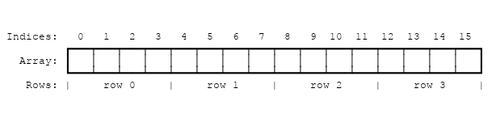

# Реализация «Игры жизни» Конвея

## Проектирование

Прежде чем углубляться в код, нужно рассмотреть несколько проектных решений.

### Бесконечная вселенная

«Игра жизни» работает в бесконечной вселенной, но у нас нет бесконечной памяти и вычислительных ресурсов. Обход этого довольно неприятного ограничения обычно сводится к одному из трех вариантов:

1.  Отслеживать, в каком подмножестве вселенной происходит что-то интересное, и расширять эту область по мере необходимости. В худшем случае расширение становится неограниченным, реализация работает все медленнее и в итоге расходует всю память.
2.  Создать вселенную фиксированного размера, где клетки на границах имеют меньше соседей, чем клетки в середине. Минус такого подхода в том, что бесконечные паттерны (например, «планеры»), достигнув края, затухают.
3.  Создать периодическую вселенную фиксированного размера, где клетки на границах имеют соседей, «заворачивающихся» на противоположную сторону. Поскольку соседи переходят через края, планеры могут двигаться бесконечно.

Мы реализуем третий вариант.

### Взаимодействие Rust и JavaScript

> ⚡ Это одна из самых важных идей, которую стоит понять и вынести из этого руководства!

Куча JavaScript с автоматической сборкой мусора — где выделяются `Object`, `Array` и узлы DOM — отделена от линейной памяти WebAssembly, где живут наши значения Rust. Сейчас у WebAssembly нет прямого доступа к куче со сборкой мусора (по состоянию на апрель 2018 года ожидается, что это изменится благодаря предложению [«Interface Types»](https://github.com/WebAssembly/interface-types/blob/master/proposals/interface-types/Explainer.md)). JavaScript, в свою очередь, может читать и писать в линейную память WebAssembly, но только как [`ArrayBuffer`](https://developer.mozilla.org/en-US/docs/Web/JavaScript/Reference/Global_Objects/ArrayBuffer) скалярных значений (`u8`, `i32`, `f64` и т.д.). Функции WebAssembly также принимают и возвращают скалярные значения. Именно это — базовые строительные блоки всего обмена данными между WebAssembly и JavaScript.

`wasm_bindgen` задает общее понимание того, как работать со сложными структурами по обе стороны этой границы. Это включает размещение структур Rust в куче с последующей оберткой указателя в JavaScript-класс для удобства, либо индексацию в таблице объектов JavaScript из Rust. `wasm_bindgen` очень удобен, но он не снимает необходимость продумывать представление данных, а также какие значения и структуры передаются через границу. Считайте его инструментом для реализации выбранного вами дизайна интерфейса.

При проектировании интерфейса между WebAssembly и JavaScript мы хотим оптимизировать следующие свойства:

1.  **Минимизировать копирование в линейную память WebAssembly и обратно.** Лишние копии дают лишние накладные расходы.
2.  **Минимизировать сериализацию и десериализацию.** Как и копирование, они создают накладные расходы и часто тоже требуют копий. Если можно передавать непрозрачные дескрипторы структуры данных — вместо сериализации на одной стороне, копирования в известное место линейной памяти WebAssembly и десериализации на другой стороне — это часто значительно снижает издержки. `wasm_bindgen` помогает определять и использовать непрозрачные дескрипторы JavaScript-`Object` или упакованных структур Rust.

Эмпирическое правило: хороший дизайн интерфейса JavaScript↔WebAssembly часто выглядит так — большие и долгоживущие структуры данных реализованы как типы Rust, живущие в линейной памяти WebAssembly, и предоставляются JavaScript как непрозрачные дескрипторы. JavaScript вызывает экспортированные функции WebAssembly, которые принимают эти дескрипторы, преобразуют данные, выполняют тяжелые вычисления, запрашивают данные и в итоге возвращают небольшой результат, который легко копировать. Возвращая только небольшой итог вычисления, мы избегаем копирования и/или сериализации больших структур туда-обратно между кучей JavaScript и линейной памятью WebAssembly.

### Взаимодействие Rust и JavaScript в нашей «Игре жизни»

Начнем с перечисления рисков, которых нужно избегать. Мы не хотим на каждом тике копировать всю вселенную в линейную память WebAssembly и обратно. Мы не хотим выделять объекты для каждой клетки вселенной и не хотим вызывать межъязыковой вызов для чтения и записи каждой клетки.

К чему это нас приводит? Мы можем представить вселенную как плоский массив в линейной памяти WebAssembly, где на каждую клетку приходится один байт. `0` — мертвая клетка, `1` — живая клетка.

Вот как выглядит в памяти вселенная размером 4 на 4:



Чтобы найти индекс массива для клетки по заданным строке и столбцу, можно использовать такую формулу:

```text
index(row, column, universe) = row * width(universe) + column
```

Есть несколько способов предоставить клетки вселенной в JavaScript. Для начала реализуем [`std::fmt::Display`](https://doc.rust-lang.org/1.25.0/std/fmt/trait.Display.html) для `Universe`, чтобы получать Rust-строку `String`, где клетки отрисованы текстовыми символами. Затем эта Rust-строка копируется из линейной памяти WebAssembly в строку JavaScript в куче JavaScript и выводится через установку HTML-свойства `textContent`. Позже в этой главе мы улучшим реализацию, чтобы не копировать клетки между кучами и рисовать прямо в `<canvas>`.

_Еще один рабочий вариант дизайна — чтобы Rust после каждого тика возвращал список только тех клеток, которые сменили состояние, вместо передачи всей вселенной в JavaScript. Тогда JavaScript при рендеринге проходил бы не по всей вселенной, а только по релевантному подмножеству. Компромисс в том, что такой дельта-подход немного сложнее в реализации._

## Реализация на Rust

В прошлой главе мы клонировали стартовый шаблон проекта. Сейчас мы его изменим.

Начнем с удаления импорта `alert` и функции `greet` из `wasm-game-of-life/src/lib.rs`, заменив их определением типа для клеток:

```rust
#[wasm_bindgen]
#[repr(u8)]
#[derive(Clone, Copy, Debug, PartialEq, Eq)]
pub enum Cell {
    Dead = 0,
    Alive = 1,
}
```

Важно иметь `#[repr(u8)]`, чтобы каждая клетка представлялась одним байтом. Также важно, чтобы вариант `Dead` был равен `0`, а вариант `Alive` — `1`, чтобы можно было просто считать число живых соседей сложением.

Далее определим вселенную. У вселенной есть ширина, высота и вектор клеток длиной `width * height`.

```rust
#[wasm_bindgen]
pub struct Universe {
    width: u32,
    height: u32,
    cells: Vec<Cell>,
}
```

Чтобы получить клетку по строке и столбцу, переводим их в индекс вектора `cells`, как описано ранее:

```rust
impl Universe {
    fn get_index(&self, row: u32, column: u32) -> usize {
        (row * self.width + column) as usize
    }

    // ...
}
```

Чтобы вычислить следующее состояние клетки, нужно посчитать, сколько ее соседей живы. Напишем для этого метод `live_neighbor_count`!

```rust
impl Universe {
    // ...

    fn live_neighbor_count(&self, row: u32, column: u32) -> u8 {
        let mut count = 0;
        for delta_row in [self.height - 1, 0, 1].iter().cloned() {
            for delta_col in [self.width - 1, 0, 1].iter().cloned() {
                if delta_row == 0 && delta_col == 0 {
                    continue;
                }

                let neighbor_row = (row + delta_row) % self.height;
                let neighbor_col = (column + delta_col) % self.width;
                let idx = self.get_index(neighbor_row, neighbor_col);
                count += self.cells[idx] as u8;
            }
        }
        count
    }
}
```

Метод `live_neighbor_count` использует смещения и операцию modulo, чтобы не писать специальные `if` для краев вселенной. При смещении `-1` мы _прибавляем_ `self.height - 1` и позволяем modulo сделать свою работу вместо вычитания `1`. `row` и `column` могут быть равны `0`, и если бы мы попытались вычесть `1`, получили бы underflow беззнакового целого.

Теперь у нас есть все, чтобы вычислить следующее поколение из текущего! Каждое правило игры прямо переводится в условие внутри выражения `match`. Дополнительно, поскольку мы хотим, чтобы момент тика контролировался из JavaScript, поместим этот метод внутрь блока `#[wasm_bindgen]`, чтобы он экспортировался в JavaScript.

```rust
/// Public methods, exported to JavaScript.
#[wasm_bindgen]
impl Universe {
    pub fn tick(&mut self) {
        let mut next = self.cells.clone();

        for row in 0..self.height {
            for col in 0..self.width {
                let idx = self.get_index(row, col);
                let cell = self.cells[idx];
                let live_neighbors = self.live_neighbor_count(row, col);

                let next_cell = match (cell, live_neighbors) {
                    // Rule 1: Any live cell with fewer than two live neighbours
                    // dies, as if caused by underpopulation.
                    (Cell::Alive, x) if x < 2 => Cell::Dead,
                    // Rule 2: Any live cell with two or three live neighbours
                    // lives on to the next generation.
                    (Cell::Alive, 2) | (Cell::Alive, 3) => Cell::Alive,
                    // Rule 3: Any live cell with more than three live
                    // neighbours dies, as if by overpopulation.
                    (Cell::Alive, x) if x > 3 => Cell::Dead,
                    // Rule 4: Any dead cell with exactly three live neighbours
                    // becomes a live cell, as if by reproduction.
                    (Cell::Dead, 3) => Cell::Alive,
                    // All other cells remain in the same state.
                    (otherwise, _) => otherwise,
                };

                next[idx] = next_cell;
            }
        }

        self.cells = next;
    }

    // ...
}
```

Пока состояние вселенной представлено вектором клеток. Чтобы сделать его удобным для чтения человеком, реализуем простейший текстовый рендерер. Идея в том, чтобы построчно выводить вселенную как текст: для живой клетки печатать Unicode-символ `◼` («черный средний квадрат»), для мертвой — `◻` («белый средний квадрат»).

Реализовав трейт [`Display`](https://doc.rust-lang.org/1.25.0/std/fmt/trait.Display.html) из стандартной библиотеки Rust, мы добавим способ форматировать структуру в пользовательском виде. Это также автоматически даст нам метод [`to_string`](https://doc.rust-lang.org/1.25.0/std/string/trait.ToString.html).

```rust
use std::fmt;

impl fmt::Display for Universe {
    fn fmt(&self, f: &mut fmt::Formatter) -> fmt::Result {
        for line in self.cells.as_slice().chunks(self.width as usize) {
            for &cell in line {
                let symbol = if cell == Cell::Dead { '◻' } else { '◼' };
                write!(f, "{}", symbol)?;
            }
            write!(f, "\n")?;
        }

        Ok(())
    }
}
```

Наконец, определим конструктор, который инициализирует вселенную интересным паттерном живых и мертвых клеток, а также метод `render`:

```rust
/// Public methods, exported to JavaScript.
#[wasm_bindgen]
impl Universe {
    // ...

    pub fn new() -> Universe {
        let width = 64;
        let height = 64;

        let cells = (0..width * height)
            .map(|i| {
                if i % 2 == 0 || i % 7 == 0 {
                    Cell::Alive
                } else {
                    Cell::Dead
                }
            })
            .collect();

        Universe {
            width,
            height,
            cells,
        }
    }

    pub fn render(&self) -> String {
        self.to_string()
    }
}
```

На этом Rust-часть реализации нашей «Игры жизни» готова!

Пересоберите ее в WebAssembly, выполнив `wasm-pack build` в директории `wasm-game-of-life`.

## Рендеринг с JavaScript

Сначала добавим элемент `<pre>` в `wasm-game-of-life/www/index.html`, в который будем рисовать вселенную, прямо над тегом `<script>`:

```html
<body>
    <pre id="game-of-life-canvas"></pre>
    <script src="./bootstrap.js"></script>
</body>
```

Кроме того, нам нужно центрировать `<pre>` посередине веб-страницы. Для этого можно использовать CSS flexbox. Добавьте следующий тег `<style>` внутри `<head>` файла `wasm-game-of-life/www/index.html`:

```html
<style>
    body {
        position: absolute;
        top: 0;
        left: 0;
        width: 100%;
        height: 100%;
        display: flex;
        flex-direction: column;
        align-items: center;
        justify-content: center;
    }
</style>
```

В начале `wasm-game-of-life/www/index.js` поправим импорт: вместо старой функции `greet` нужно импортировать `Universe`:

```js
import { Universe } from 'wasm-game-of-life';
```

Также получим добавленный элемент `<pre>` и создадим новую вселенную:

```js
const pre = document.getElementById('game-of-life-canvas');
const universe = Universe.new();
```

JavaScript выполняется [в цикле `requestAnimationFrame`](https://developer.mozilla.org/en-US/docs/Web/API/window/requestAnimationFrame). На каждой итерации он рисует текущее состояние вселенной в `<pre>`, а затем вызывает `Universe::tick`.

```js
const renderLoop = () => {
    pre.textContent = universe.render();
    universe.tick();

    requestAnimationFrame(renderLoop);
};
```

Чтобы запустить процесс рендеринга, достаточно сделать начальный вызов для первой итерации цикла:

```js
requestAnimationFrame(renderLoop);
```

Убедитесь, что сервер разработки все еще запущен (выполните `npm run start` в `wasm-game-of-life/www`), и вот так должна выглядеть страница [http://localhost:8080/](http://localhost:8080/):

[Скриншот реализации «Игры жизни» с текстовым рендерингом](./initial-game-of-life-pre.png)

## Рендеринг в Canvas напрямую из памяти

Генерация (и выделение памяти под) `String` в Rust, а затем преобразование ее в валидную строку JavaScript через `wasm-bindgen` приводит к лишним копиям клеток вселенной. Поскольку код JavaScript уже знает ширину и высоту вселенной и может напрямую читать линейную память WebAssembly, где лежат клетки, мы изменим метод `render`, чтобы он возвращал указатель на начало массива клеток.

Также вместо рендеринга Unicode-текста перейдем к использованию [Canvas API](https://developer.mozilla.org/en-US/docs/Web/API/Canvas_API). Эту схему мы будем использовать в оставшейся части руководства.

В `wasm-game-of-life/www/index.html` заменим добавленный ранее `<pre>` на `<canvas>`, в который будем рисовать (он тоже должен быть внутри `<body>`, перед `<script>`, подключающим JavaScript):

```html
<body>
    <canvas id="game-of-life-canvas"></canvas>
    <script src="./bootstrap.js"></script>
</body>
```

Чтобы получить нужные данные из реализации на Rust, добавим несколько геттеров: ширина, высота вселенной и указатель на массив ее клеток. Все они также экспортируются в JavaScript. Внесите эти изменения в `wasm-game-of-life/src/lib.rs`:

```rust
/// Public methods, exported to JavaScript.
#[wasm_bindgen]
impl Universe {
    // ...

    pub fn width(&self) -> u32 {
        self.width
    }

    pub fn height(&self) -> u32 {
        self.height
    }

    pub fn cells(&self) -> *const Cell {
        self.cells.as_ptr()
    }
}
```

Далее в `wasm-game-of-life/www/index.js` также импортируем `Cell` из `wasm-game-of-life` и определим несколько констант, которые будем использовать при рендеринге в canvas:

```js
import { Universe, Cell } from 'wasm-game-of-life';

const CELL_SIZE = 5; // px
const GRID_COLOR = '#CCCCCC';
const DEAD_COLOR = '#FFFFFF';
const ALIVE_COLOR = '#000000';
```

Теперь перепишем остальную часть JavaScript-кода: вместо записи в `textContent` у `<pre>` будем рисовать в `<canvas>`:

```js
// Construct the universe, and get its width and height.
const universe = Universe.new();
const width = universe.width();
const height = universe.height();

// Give the canvas room for all of our cells and a 1px border
// around each of them.
const canvas = document.getElementById(
    'game-of-life-canvas'
);
canvas.height = (CELL_SIZE + 1) * height + 1;
canvas.width = (CELL_SIZE + 1) * width + 1;

const ctx = canvas.getContext('2d');

const renderLoop = () => {
    universe.tick();

    drawGrid();
    drawCells();

    requestAnimationFrame(renderLoop);
};
```

Чтобы нарисовать сетку между клетками, рисуем набор горизонтальных линий с равным шагом и набор вертикальных линий с равным шагом. Пересекаясь, они образуют сетку.

```js
const drawGrid = () => {
    ctx.beginPath();
    ctx.strokeStyle = GRID_COLOR;

    // Vertical lines.
    for (let i = 0; i <= width; i++) {
        ctx.moveTo(i * (CELL_SIZE + 1) + 1, 0);
        ctx.lineTo(
            i * (CELL_SIZE + 1) + 1,
            (CELL_SIZE + 1) * height + 1
        );
    }

    // Horizontal lines.
    for (let j = 0; j <= height; j++) {
        ctx.moveTo(0, j * (CELL_SIZE + 1) + 1);
        ctx.lineTo(
            (CELL_SIZE + 1) * width + 1,
            j * (CELL_SIZE + 1) + 1
        );
    }

    ctx.stroke();
};
```

Мы можем напрямую обращаться к линейной памяти WebAssembly через `memory`, которая определена в сыром wasm-модуле `wasm_game_of_life_bg`. Чтобы рисовать клетки, получаем указатель на массив клеток вселенной, создаем `Uint8Array`, накладывающийся на буфер клеток, проходим по каждой клетке и рисуем белый или черный прямоугольник в зависимости от того, мертва клетка или жива. За счет работы с указателями и overlay-массивом мы избегаем копирования клеток через границу на каждом тике.

```js
// Import the WebAssembly memory at the top of the file.
import { memory } from 'wasm-game-of-life/wasm_game_of_life_bg';

// ...

const getIndex = (row, column) => {
    return row * width + column;
};

const drawCells = () => {
    const cellsPtr = universe.cells();
    const cells = new Uint8Array(
        memory.buffer,
        cellsPtr,
        width * height
    );

    ctx.beginPath();

    for (let row = 0; row < height; row++) {
        for (let col = 0; col < width; col++) {
            const idx = getIndex(row, col);

            ctx.fillStyle =
                cells[idx] === Cell.Dead
                    ? DEAD_COLOR
                    : ALIVE_COLOR;

            ctx.fillRect(
                col * (CELL_SIZE + 1) + 1,
                row * (CELL_SIZE + 1) + 1,
                CELL_SIZE,
                CELL_SIZE
            );
        }
    }

    ctx.stroke();
};
```

Чтобы запустить рендеринг, используем тот же код, что и выше, для старта первой итерации цикла:

```js
drawGrid();
drawCells();
requestAnimationFrame(renderLoop);
```

Обратите внимание: здесь мы вызываем `drawGrid()` и `drawCells()` _до_ `requestAnimationFrame()`. Это сделано для того, чтобы _начальное_ состояние вселенной было нарисовано до внесения изменений. Если бы мы просто вызвали `requestAnimationFrame(renderLoop)`, первый отрисованный кадр оказался бы уже _после_ первого вызова `universe.tick()`, то есть фактически соответствовал бы второму «тику» жизни этих клеток.

## Работает!

Пересоберите WebAssembly и «клей» биндингов, выполнив эту команду из корневой директории `wasm-game-of-life`:

```
wasm-pack build
```

Убедитесь, что сервер разработки все еще запущен. Если нет — запустите его снова из директории `wasm-game-of-life/www`:

```
npm run start
```

Если обновить [http://localhost:8080/](http://localhost:8080/), вы увидите впечатляющую демонстрацию жизни!

[Скриншот реализации «Игры жизни»](./initial-game-of-life.png)

К слову, существует еще очень интересный алгоритм реализации «Игры жизни» под названием [hashlife](https://en.wikipedia.org/wiki/Hashlife). Он активно использует мемоизацию и со временем может вычислять будущие поколения _экспоненциально быстрее_! Возможно, вы задаетесь вопросом, почему мы не реализовали hashlife в этом руководстве. Это выходит за рамки текущего текста, где мы сосредоточены на интеграции Rust и WebAssembly, но мы настоятельно рекомендуем изучить hashlife самостоятельно.

## Упражнения

-   Инициализируйте вселенную одним космическим кораблем.

-   Вместо жестко заданной начальной вселенной сгенерируйте случайную, где каждая клетка с вероятностью 50/50 будет живой или мертвой.

    _Подсказка: используйте [crate `js-sys`](https://crates.io/crates/js-sys), чтобы импортировать [JavaScript-функцию `Math.random`](https://developer.mozilla.org/en-US/docs/Web/JavaScript/Reference/Global_Objects/Math/random)._

    ???question "Ответ"

        _Сначала добавьте `js-sys` как зависимость в `wasm-game-of-life/Cargo.toml`:_

        ```toml
        # ...
        [dependencies]
        js-sys = "0.3"
        # ...
        ```

        _Затем используйте функцию `js_sys::Math::random`, чтобы «подбросить монетку»:_

        ```rust
        extern crate js_sys;

        // ...

        if js_sys::Math::random() < 0.5 {
        	// Alive...
        } else {
        	// Dead...
        }
        ```

-   Представление каждой клетки одним байтом упрощает обход клеток, но расходует лишнюю память. В каждом байте восемь бит, а нам нужен только один бит, чтобы хранить состояние клетки (жива или мертва). Переделайте представление данных так, чтобы каждая клетка занимала только один бит.

    ???question "Ответ"

        В Rust можно использовать [crate `fixedbitset` и тип `FixedBitSet`](https://crates.io/crates/fixedbitset), чтобы представлять клетки вместо `Vec<Cell>`:

        ```rust
        // Make sure you also added the dependency to Cargo.toml!
        extern crate fixedbitset;
        use fixedbitset::FixedBitSet;

        // ...

        #[wasm_bindgen]
        pub struct Universe {
        	width: u32,
        	height: u32,
        	cells: FixedBitSet,
        }
        ```

        Конструктор `Universe` можно изменить следующим образом:

        ```rust
        pub fn new() -> Universe {
        	let width = 64;
        	let height = 64;

        	let size = (width * height) as usize;
        	let mut cells = FixedBitSet::with_capacity(size);

        	for i in 0..size {
        		cells.set(i, i % 2 == 0 || i % 7 == 0);
        	}

        	Universe {
        		width,
        		height,
        		cells,
        	}
        }
        ```

        Чтобы обновить клетку на следующем тике вселенной, используем метод `set` у `FixedBitSet`:

        ```rust
        next.set(idx, match (cell, live_neighbors) {
        	(true, x) if x < 2 => false,
        	(true, 2) | (true, 3) => true,
        	(true, x) if x > 3 => false,
        	(false, 3) => true,
        	(otherwise, _) => otherwise
        });
        ```

        Чтобы передать указатель на начало битов в JavaScript, можно преобразовать `FixedBitSet` в slice, а затем преобразовать slice в указатель:

        ```rust
        #[wasm_bindgen]
        impl Universe {
        	// ...

        	pub fn cells(&self) -> *const u32 {
        		self.cells.as_slice().as_ptr()
        	}
        }
        ```

        В JavaScript создание `Uint8Array` из памяти Wasm выглядит так же, как и раньше, кроме того, что длина массива теперь не `width * height`, а `width * height / 8`, так как теперь у нас одна клетка на бит, а не на байт:

        ```js
        const cells = new Uint8Array(
        	memory.buffer,
        	cellsPtr,
        	(width * height) / 8
        );
        ```

        Имея индекс и `Uint8Array`, можно определить, установлен ли _n<sup>th</sup>_ бит, с помощью такой функции:

        ```js
        const bitIsSet = (n, arr) => {
        	const byte = Math.floor(n / 8);
        	const mask = 1 << n % 8;
        	return (arr[byte] & mask) === mask;
        };
        ```

        С учетом всего вышесказанного новая версия `drawCells` выглядит так:

        ```js
        const drawCells = () => {
        	const cellsPtr = universe.cells();

        	// This is updated!
        	const cells = new Uint8Array(
        		memory.buffer,
        		cellsPtr,
        		(width * height) / 8
        	);

        	ctx.beginPath();

        	for (let row = 0; row < height; row++) {
        		for (let col = 0; col < width; col++) {
        			const idx = getIndex(row, col);

        			// This is updated!
        			ctx.fillStyle = bitIsSet(idx, cells)
        				? ALIVE_COLOR
        				: DEAD_COLOR;

        			ctx.fillRect(
        				col * (CELL_SIZE + 1) + 1,
        				row * (CELL_SIZE + 1) + 1,
        				CELL_SIZE,
        				CELL_SIZE
        			);
        		}
        	}

        	ctx.stroke();
        };
        ```
